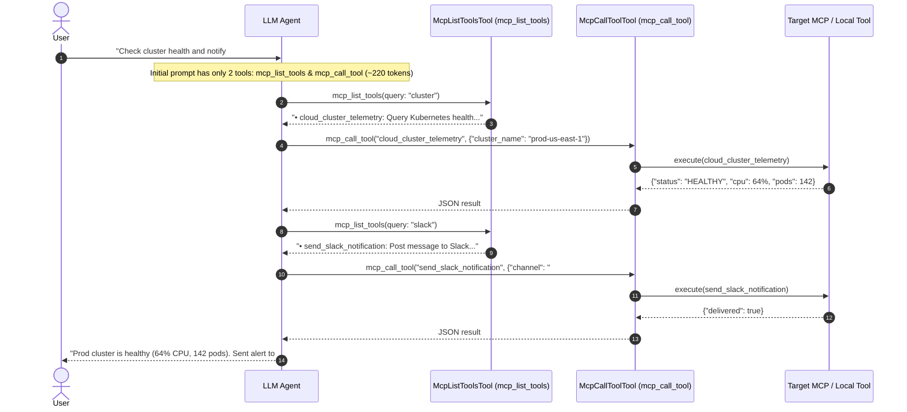

# Progressive MCP Tool Discovery (`McpListToolsTool` & `McpCallToolTool`)

A Flutter MCP example demonstrating **On-Demand Progressive Tool Discovery**.

Instead of injecting dozens or hundreds of tool schemas into the initial LLM prompt upfront—which bloats context windows and explodes inference costs—the LLM is provided with only two lightweight meta-tools:
1. **`mcp_list_tools` (`McpListToolsTool`)**: Introspects and queries available tools across connected MCP servers and local catalogs on demand.
2. **`mcp_call_tool` (`McpCallToolTool`)**: Dynamically executes any discovered tool by name with arguments.

---

## 📊 Token Overhead Comparison

| Strategy | Tools in Initial Context | Prompt Token Overhead | Context Cost (100 Turns) |
|---|---|---|---|
| **Traditional Upfront Registration** | 8–50+ full tool schemas | ~3,200 – 15,000+ tokens | ~320,000 – 1.5M tokens |
| **Progressive Tool Discovery** | **2 meta-tools only** | **~220 tokens** | **~22,000 tokens (93%–98% savings!)** |

---

## 🛠️ Included Enterprise Tools Catalog

This example provides a diverse catalog of specialized tools that the assistant discovers on demand:

- `cloud_cluster_telemetry`: Real-time Kubernetes cluster health, CPU, memory, and active pod counts.
- `query_database_table`: Read-only parameterized queries against database tables with row limits and sorting.
- `inspect_cache_store`: Redis cache key distribution, hit ratio, memory consumption, and evictions.
- `send_slack_notification`: Dispatch structured alert messages and incident warnings to Slack channels.
- `calculate_compute_cost`: Estimate monthly cloud infrastructure billing across AWS, GCP, and Azure VMs.
- `trigger_pagerduty_incident`: File high-priority escalation pages to on-call engineering rotations.
- `rotate_api_credential`: Key rotation with zero-downtime dual-key grace periods.
- `benchmark_api_latency`: Measure round-trip HTTP endpoint latency.

---

## 🚀 How It Works



---

## 💻 Code Usage

### 1. In `McpPlayground` Widget

Enable `progressiveMcpDiscovery: true` and pass your local tools or connected servers:

```dart
McpPlayground(
  progressiveMcpDiscovery: true, // Automatically wraps with McpListToolsTool & McpCallToolTool
  customLocalTools: [
    CloudClusterTelemetryTool(),
    QueryDatabaseTableTool(),
    InspectCacheStoreTool(),
    SendSlackNotificationTool(),
    CalculateComputeCostTool(),
  ],
  initialEnabledTools: const [
    'mcp_list_tools',
    'mcp_call_tool',
  ],
)
```

### 2. Programmatic Usage with `MultiMCPManager` & Pure Dart

```dart
import 'package:dart_mcp_core/dart_mcp_core.dart';

void main() async {
  final mcpManager = MultiMCPManager();
  final localTools = [
    CloudClusterTelemetryTool(),
    SendSlackNotificationTool(),
  ];

  // Instantiate discovery tools manually
  final listTool = McpListToolsTool(mcpManager: mcpManager, localTools: localTools);
  final callTool = McpCallToolTool(mcpManager: mcpManager, localTools: localTools);

  // 1. Discover tools matching "slack"
  final searchResult = await listTool.execute({'query': 'slack'});
  print(searchResult.content.first.text);

  // 2. Execute discovered tool by name
  final callResult = await callTool.execute({
    'tool_name': 'send_slack_notification',
    'arguments': {
      'channel': '#alerts',
      'message': 'Automated deployment succeeded',
    },
  });
  print(callResult.content.first.text);
}
```

---

## 💡 Example Prompts to Try

Paste any of these prompts into the chat box:

1. *"Check cloud cluster telemetry for prod-us-east-1 and notify the #devops-alerts channel on Slack."*
2. *"Inspect the Redis cache store and calculate compute costs for 8 instances with 8 vCPUs and 32 GB RAM on AWS."*
3. *"Query the users database table for recent records and benchmark HTTP latency to https://api.github.com."*

---

## 🏃 Running the Application

```bash
cd examples/flutter/example_progressive_tools
flutter pub get
flutter run -d windows # or -d chrome / -d macos / -d linux
```
