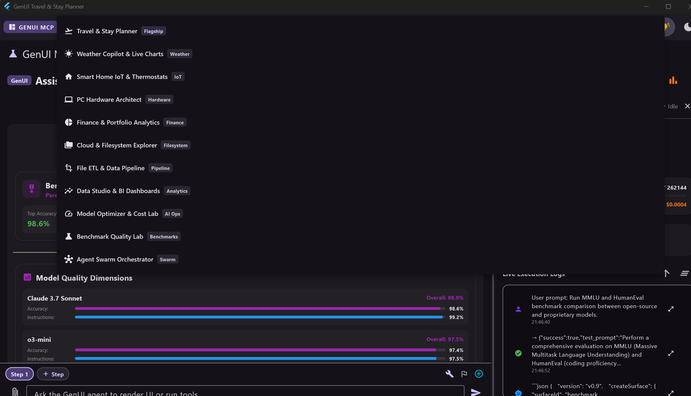
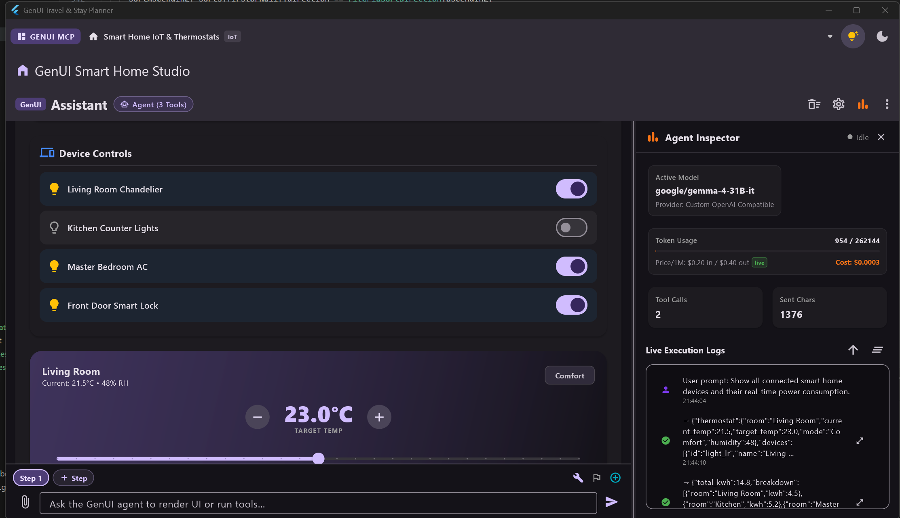
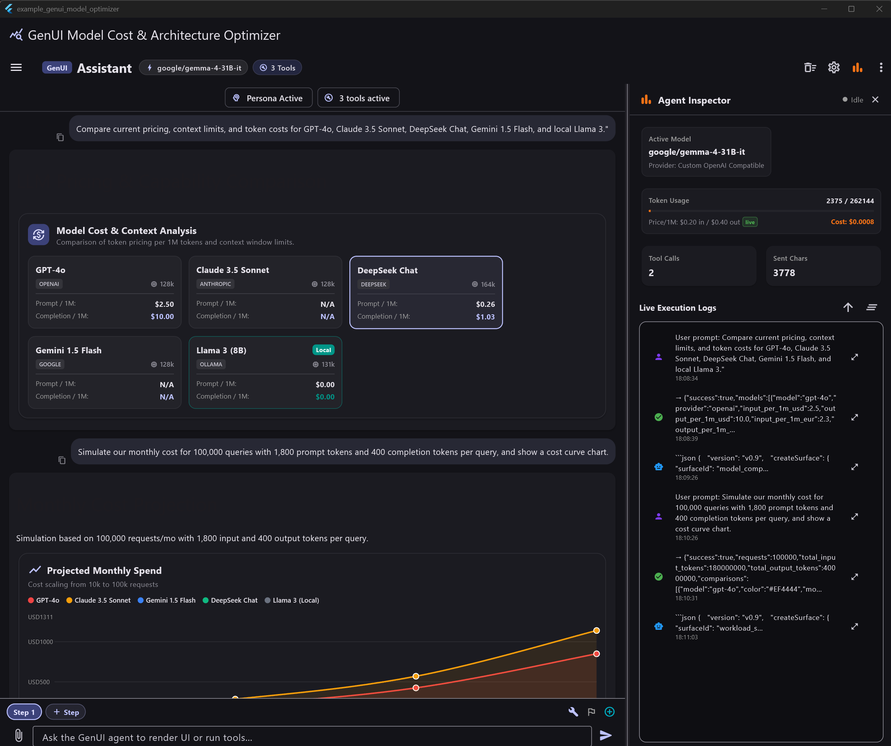
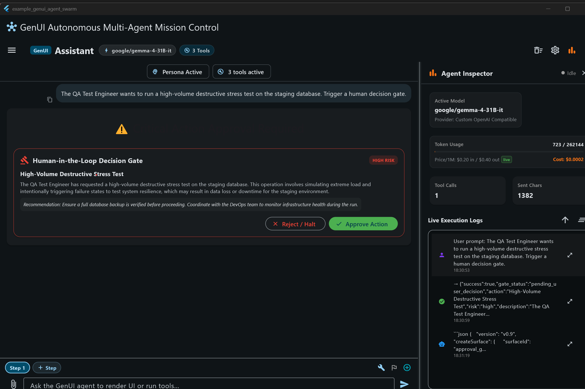
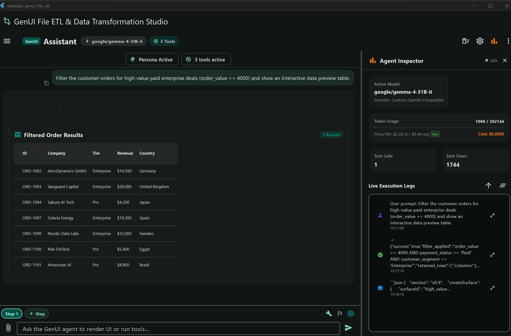
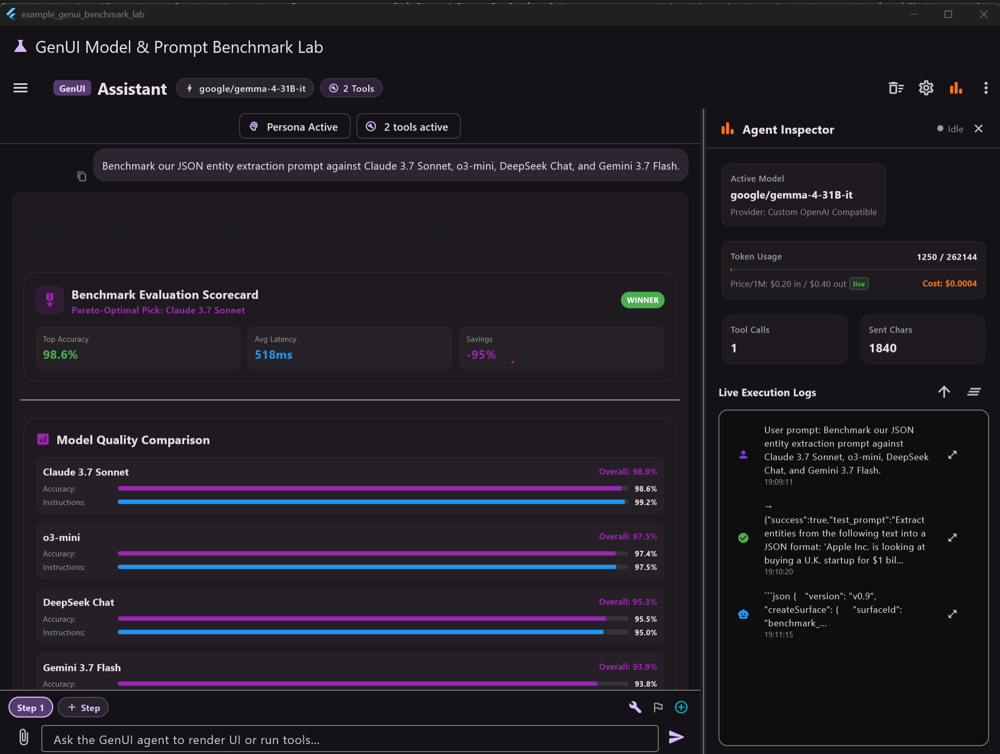
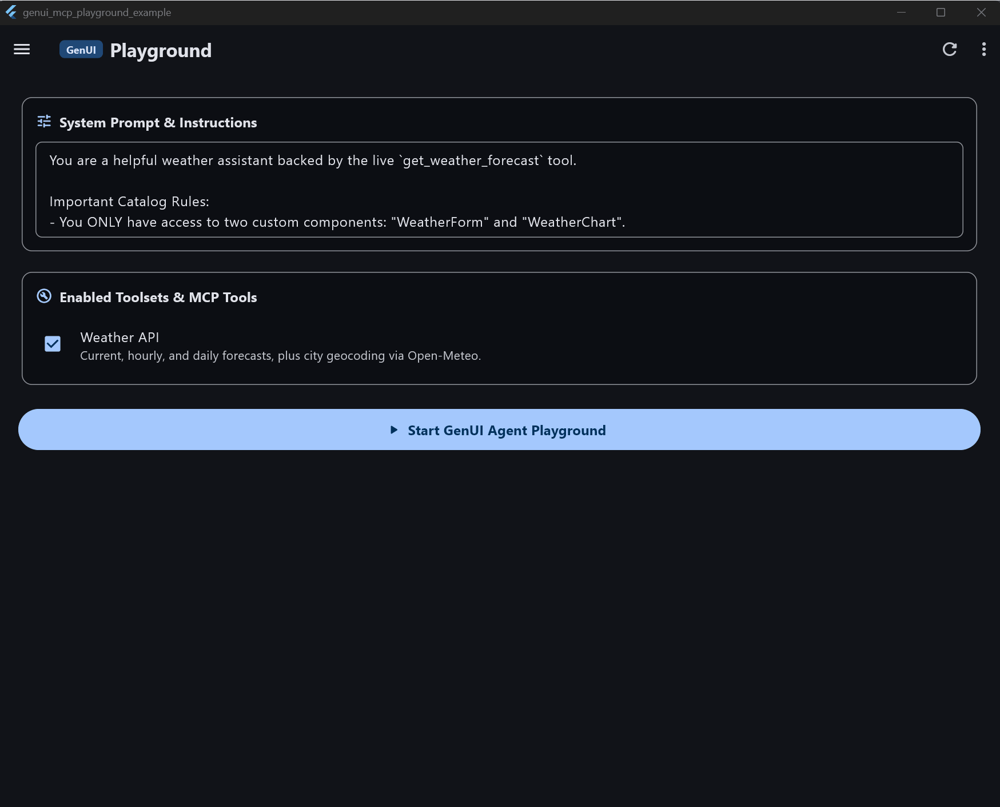
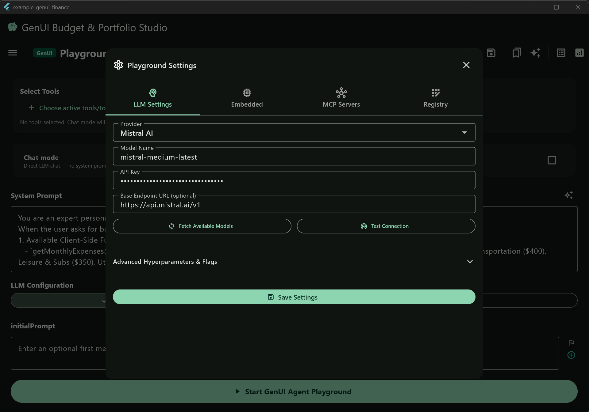

# flutter_a2ui_mcp

An interactive, dynamic **A2UI & Agentic MCP Widget** for Flutter.

`flutter_a2ui_mcp` brings together Google's **A2UI** (`Agent-to-User Interface`, successor to `GenUI`), the **Model Context Protocol (MCP)**, and native Dart tools. It enables LLMs to emit structured UI components and render rich, interactive Flutter widgets directly in the conversation flow, while retaining full agentic tool-calling capabilities and live state inspection.

---

## ✨ Features

- **Dynamic A2UI Surface Rendering** – Render model-generated interactive forms, cards, tables, and custom widgets directly inline in the chat transcript.
- **Pluggable A2UI Catalog** – Define custom components using JSON schemas (`A2uiCatalogItemDefinition`) or Dart builders with `basicCatalog()` and `ComponentImplementation`.
- **Multi-LLM Support** – OpenAI, Anthropic Claude, Google Gemini, Ollama (local), Mistral AI, and custom OpenAI-compatible endpoints.
- **Embedded On-Device LLMs** – Run GGUF models locally with `llamadart` without network dependencies.
- **MCP & Local Tool Calling** – Connect remote HTTP/SSE MCP servers, local subprocess servers, and Dart-native tools.
- **App Embedding Support & Visibility Controls** – Fully customizable header controls (`showAppBar`, `showStatusBadges`, `showSkillsControls`, `showAssistantStatistics`, `showMemoryArchive`, `showToolsCatalog`, `showWorkflowActions`) for embedding directly into host applications.
- **Interactive Agent Inspector & Top-Bar Toggle** – Side-by-side live inspection of system prompts, tool calls, JSON payloads, and execution traces.
- **Cross-Platform** – Android, iOS, macOS, Windows, Linux, and Web.

---

## 🎥 Demos & Visual Showcases

Watch dynamic A2UI in action rendering interactive surfaces across all showcase examples:

### 🎛️ Unified A2UI Showcase Gallery & Feature Switcher
Explore, switch, and interact with all A2UI showcase scenarios directly from the top bar:



### 🏡 A2UI Smart Home Studio (Thermostat, Lighting & IoT)
Interactive climate controls, lighting sliders, device status toggles, and energy breakdown charts:



### 💰 A2UI Model Cost & Architecture Optimizer


### 🤖 A2UI Autonomous Multi-Agent Mission Control


### 📊 A2UI File ETL & Data Transformation Studio


### 🔬 A2UI Model & Prompt Benchmark Lab


### 🏖️ A2UI Travel & Stay Planner


### ⛅ A2UI Weather Generator


### 📈 A2UI Finance & Budget Planner


---

## 🚀 Installation

Add to your `pubspec.yaml`:

```yaml
dependencies:
  flutter_a2ui_mcp: ^1.0.0
  a2ui_flutter: ^0.3.0
  a2ui_core: ^0.7.0
```

Then import:

```dart
import 'package:flutter_a2ui_mcp/flutter_a2ui_mcp.dart';
```

---

## 💡 Quick Start

```dart
import 'package:flutter/material.dart';
import 'package:flutter_a2ui_mcp/flutter_a2ui_mcp.dart';

void main() {
  runApp(const MyApp());
}

class MyApp extends StatelessWidget {
  const MyApp({super.key});

  @override
  Widget build(BuildContext context) {
    return const MaterialApp(
      home: Scaffold(
        body: A2uiMcpPlayground(
          initialLlmConfig: LlmConfig(
            provider: LlmProvider.gemini,
            model: 'gemini-2.5-flash',
            apiKey: 'YOUR_GEMINI_API_KEY',
          ),
        ),
      ),
    );
  }
}
```

---

## 🧩 Adding Custom Catalog Components

You can provide custom components to the A2UI catalog via `a2uiCatalogItems`:

```dart
A2uiMcpPlayground(
  a2uiCatalogItems: [
    A2uiCatalogItemDefinition(
      name: 'CounterCard',
      description: 'A custom counter card widget',
      schema: S.object(
        properties: {
          'title': S.string(description: 'Card title'),
          'initialCount': S.integer(description: 'Starting count'),
        },
        required: ['title'],
      ),
      builder: (context, data) {
        final title = data['title'] as String? ?? 'Counter';
        return Card(
          child: Padding(
            padding: const EdgeInsets.all(16.0),
            child: Text(title, style: const TextStyle(fontWeight: FontWeight.bold)),
          ),
        );
      },
    ),
  ],
)
```

---

## 🔄 Migrating from `flutter_genui_mcp`

`flutter_a2ui_mcp` is the official successor to `flutter_genui_mcp`. For seamless migration:

- Replace `flutter_genui_mcp` dependency with `flutter_a2ui_mcp`.
- Replace `import 'package:flutter_genui_mcp/flutter_genui_mcp.dart';` with `import 'package:flutter_a2ui_mcp/flutter_a2ui_mcp.dart';`.
- `FlutterGenUiMcp` and `GenuiMcpPlayground` remain supported as backward-compatible typedefs pointing to `A2uiMcpPlayground`.
- Rename `genuiCatalogItems` parameter to `a2uiCatalogItems`.

