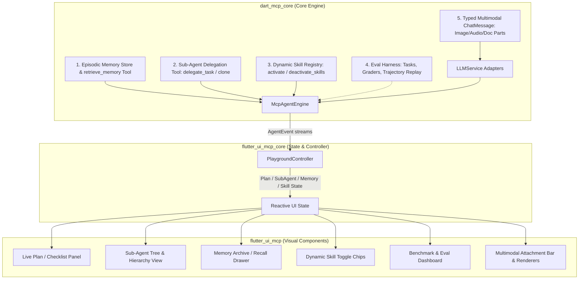

# Implementation Plan: Advancing `dart_mcp_core` & UI Ecosystem

This plan outlines the architecture and execution roadmap for implementing 5 strategic features in **`dart_mcp_core`** (inspired by best-in-class agent frameworks like `dart_agent_core`), along with the corresponding UI enhancements required in **`flutter_ui_mcp_core`** and **`flutter_ui_mcp`**.

---

## 🎯 Architecture Overview



---

## 📦 Part 1: Core Implementation in `dart_mcp_core`

### 1. Episodic Memory Store & `retrieve_memory` Tool
> **Goal:** Prevent permanent information loss when conversation history is summarized by context compression. Allow the agent to recall verbatim past turns on demand.

* **Data Structure (`EpisodicMemoryStore`)**:
  - Keep an indexed in-memory (and optionally file-persisted) archive of compressed message chunks:
    ```dart
    class EpisodicMemoryEntry {
      final String archiveId;
      final int startTurnIndex;
      final int endTurnIndex;
      final DateTime timestamp;
      final List<ChatMessage> rawMessages;
      final String summary;
    }
    ```
  - When `ContextCompressor.compress()` executes, it saves the chunk of raw messages to the agent's `EpisodicMemoryStore` before replacing them in active history.
* **Built-in Local Tool (`RetrieveMemoryTool`)**:
  - Exposes `retrieve_memory({String? query, int? turnIndex, String? archiveId})` to the agent.
  - Returns verbatim raw conversation turns or keyword/semantic matches so the model can inspect compressed facts on demand.
* **Engine Event**:
  - Emits `AgentMemoryRetrievedEvent(archiveId, recalledTurnCount, query)`.

---

### 2. Sub-Agent Delegation (`delegate_task` / `clone`)
> **Goal:** Enable the primary agent to delegate focused sub-tasks to specialized worker agents or clean clones with isolated context windows, preventing context bloat and reasoning degradation.

* **Built-in Local Tool (`DelegateTaskTool`)**:
  ```dart
  // Tool parameters:
  // - assignee: 'clone' | '<registered_agent_key>'
  // - task: String (detailed prompt/instruction for the sub-agent)
  // - enabledTools: List<String>? (optional tool subset)
  ```
* **Engine Execution**:
  - When invoked, `McpAgentEngine` spawns a child worker turn.
  - If `assignee == 'clone'`, it instantiates an agent with the same LLM config and tools, but with a clean, isolated history.
  - If `assignee == 'key'`, it looks up the registered sub-agent by key.
* **Recursion Guard**:
  - Flag `isSubAgent: true` or `delegationDepth` limit (default max depth: 2) to prevent recursive loops. Sub-agents cannot re-delegate if max depth is reached.
* **Engine Events**:
  - `AgentSubAgentStartedEvent(parentKey, subAgentKey, task)`
  - `AgentSubAgentProgressEvent(subAgentKey, subEvent)`
  - `AgentSubAgentCompletedEvent(parentKey, subAgentKey, result)`

---

### 3. Dynamic Skill Activation (`activate_skills` / `deactivate_skills`)
> **Goal:** Keep the system prompt and tool schema list lean. Only publish lightweight skill metadata initially, and let the agent activate or deactivate skill toolsets dynamically at runtime.

* **Skill Abstraction (`SkillDefinition`)**:
  - Bundles: `name`, `description`, `systemPrompt`, and `List<McpLocalTool> tools`.
  - Can be marked `isAlwaysOn: bool` (default `false`).
* **Dynamic Mode & System Prompt Optimization**:
  - Non-active skills only publish their name and a 1-sentence description in the system prompt. Their full tool schemas are omitted from the initial LLM call.
  - Inject tools: `ActivateSkillsTool(['skill_name'])` and `DeactivateSkillsTool(['skill_name'])`.
  - When the model calls `activate_skills('git_reviewer')`, the engine loads its prompt segment and registers its tools into the active dispatch table for subsequent iterations.
* **Engine Event**:
  - `AgentSkillsChangedEvent(activeSkills, deactivatedSkills)`.

---

### 4. Record / Replay Evaluation Harness (`evals`)
> **Goal:** Benchmark agent reliability, measure success rates (`pass@1`, `pass@k`), and run regression tests without making live LLM calls.

* **Trajectory Recorder (`EvalTrajectoryRecorder`)**:
  - Serializes full execution runs: prompts, tool calls, tool results, tokens, latency, and final response into JSON transcripts.
* **Mock / Replay LLM Adapter (`ReplayLlmService`)**:
  - Replays cached responses during automated test runs without spending API tokens or running heavy GGUF inference in CI.
* **Graders & Metrics**:
  - `ExactMatchGrader`, `ToolCallValidator` (did it call `fs_replace_text`?), `RegexGrader`, and `LlmJudgeGrader`.
  - Computes `pass@1`, `pass@k`, latency, and token cost.
* **Eval Runner**:
  - CLI runner or programmatic runner: `EvalSuite.run() -> EvalReport`.

---

### 5. Multimodal Content Support in `ChatMessage`
> **Goal:** Provide native, typed support for images, documents, and audio across all supported LLM providers.

* **Typed Content Parts**:
  ```dart
  sealed class ChatContentPart {}
  class TextPart extends ChatContentPart { 
    final String text; 
    const TextPart(this.text);
  }
  class ImagePart extends ChatContentPart { 
    final Uint8List? bytes; 
    final String? base64; 
    final String? url; 
    final String mimeType; 
    const ImagePart({this.bytes, this.base64, this.url, required this.mimeType});
  }
  class DocumentPart extends ChatContentPart { 
    final Uint8List bytes; 
    final String fileName; 
    final String mimeType; 
    const DocumentPart({required this.bytes, required this.fileName, required this.mimeType});
  }
  class AudioPart extends ChatContentPart { 
    final Uint8List bytes; 
    final String mimeType; 
    const AudioPart({required this.bytes, required this.mimeType});
  }
  ```
* **`ChatMessage` Update**:
  - Add `List<ChatContentPart>? parts;` alongside `String content`.
  - Update `LLMService` adapters (OpenAI, Gemini, Claude, Ollama) to map `ChatContentPart` to native provider payloads (e.g. Gemini `InlineDataPart`, OpenAI `imageUrl`, Claude `image`).

---

## 🎨 Part 2: Impact & Improvements in the UI Packages

Once the core is updated, here is what must be improved in **`flutter_ui_mcp_core`** and **`flutter_ui_mcp`**:

### 1. `flutter_ui_mcp_core` (Controller & State Layer)

| New Core Feature | State & Controller Additions in `PlaygroundController` |
| :--- | :--- |
| **Episodic Memory** | • Add `List<EpisodicMemoryEntry> memoryArchive`<br>• Listen for `AgentMemoryRetrievedEvent` to flag in chat which messages triggered a memory lookup. |
| **Sub-Agent Delegation** | • Add `Map<String, SubAgentExecutionState> activeSubAgents`<br>• Listen to `AgentSubAgentStartedEvent` & `AgentSubAgentCompletedEvent` to build a hierarchical execution tree. |
| **Dynamic Skills** | • Add `Set<String> activeSkillNames`<br>• Methods: `toggleSkill(String name)`, `setSkills(List<String>)`<br>• Auto-sync state when `AgentSkillsChangedEvent` arrives from LLM tool calls. |
| **Multimodal Messages** | • Add `List<ChatContentPart> pendingAttachments` in the controller for the user prompt box.<br>• Methods: `attachImage(Uint8List, String)`, `removeAttachment(int index)`. |
| **Evaluation Suite** | • Add `EvalControllerState` to manage test task loading, execution progress, and score caching. |

---

### 2. `flutter_ui_mcp` (Widgets & Visual Presentation)

#### A. Sub-Agent Execution Tree & Collapsible Threads
- **Current**: All logs, tool calls, and assistant thoughts stream into a single flat vertical list.
- **Improvement**: 
  - Sub-agent calls render as **nested expandable cards/drawers** (e.g., `[Sub-Agent: researcher] → Finding articles... (3 tool calls) → [Result preview]`).
  - Keeps the main chat clean while letting developers drill into child agent trajectories.

#### B. Episodic Memory Drawer & Recall Indicators
- **Improvement**:
  - Add a **Memory Archive** tab/drawer in the playground where users can view all compressed turn blocks.
  - When the agent recalls memory via `retrieve_memory`, display a subtle badge: `"💡 Recalled context from Turn #3 (20 min ago)"`.

#### C. Live Skill Dock / Toggle Chips
- **Improvement**:
  - In the top action bar or sidebar, display registered skills as interactive chips (e.g., `[📦 SQLite] [🔍 Web Search] [💻 Git Review]`).
  - Chips glow/activate when the LLM triggers `activate_skills`, and users can also click to manually toggle them on/off.

#### D. Multimodal Input Bar & Renderers
- **Improvement**:
  - **Attachment Bar**: Add a paperclip / image button to the chat input supporting drag-and-drop and clipboard paste (`Ctrl+V` screenshot).
  - **Thumbnail Previews**: Show removable image pills above the prompt textfield.
  - **Message Rendering**: Render image attachments with lightbox zoom in the user and assistant bubbles.

#### E. Evals & Model Benchmark Panel
- **Improvement**:
  - Add an **Evaluations & Benchmark View** in the UI:
    - Select an eval suite (e.g. "Coding Tools Verification", "Weather Queries").
    - Select a model (e.g., Compare `gpt-4o-mini` vs `qwen2.5-coder-7b` embedded GGUF).
    - Progress bar running through tasks, showing Pass/Fail status, latency graphs, and token cost breakdown.
  - Add a `"Save as Eval Test Case"` button on any message in chat history to turn tricky edge cases into regression tests with one click.

---

## 📅 Execution Sequence

1. **Phase 1: `dart_mcp_core` Core Primitives & Tools**
   - Add `ChatContentPart` model & provider mappings.
   - Implement `EpisodicMemoryStore` & `RetrieveMemoryTool` in `context/`.
   - Implement `SkillDefinition`, `ActivateSkillsTool`, and dynamic tool filtering in `skills/`.
   - Implement `DelegateTaskTool` and sub-agent recursion guards in `agents/`.
   - Implement `eval/` harness (trajectory record/replay and graders).

2. **Phase 2: `flutter_ui_mcp_core` Reactive Controller Extensions**
   - Wire event listeners for `AgentSubAgent*`, `AgentMemoryRetrievedEvent`, and `AgentSkillsChangedEvent`.
   - Add reactive collections for `memoryArchive`, `activeSubAgents`, and `pendingAttachments`.

3. **Phase 3: `flutter_ui_mcp` Visual Components**
   - Build sub-agent nested expansion widgets.
   - Build episodic memory archive viewer.
   - Build skill chips dock and multimodal attachment bar.
   - Build the eval benchmark runner tab.
