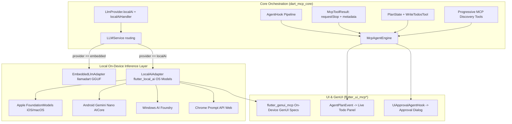

# Architectural Improvements Plan: Flutter MCP Suite

This plan synthesizes architectural enhancements inspired by `dart_agent_core` and `flutter_local_ai` into the **Flutter MCP Suite** (`dart_mcp_core`, `flutter_ui_mcp_core`, `flutter_ui_mcp`, and `flutter_genui_mcp`).

---

## 🎯 Objectives & Design Philosophy

1. **First-Class OS-Native On-Device AI (`LocalAI`)**: Direct integration with Apple FoundationModels (iOS 18.1+), Android Gemini Nano (AICore), Windows AI Foundry, and Chrome Prompt API via `flutter_local_ai` alongside the existing GGUF `llamadart` engine.
2. **Keep Pure Dart Core Pure**: Maintain zero Flutter/GUI dependencies in `dart_mcp_core`. Pluggable static delegate hooks (`LLMService.localAiHandler`, `LLMService.embeddedHandler`) keep core decoupled from native OS plugins.
3. **Preserve Backward Compatibility**: Existing tools, agents, and configurations must continue to work seamlessly.
4. **Incremental Delivery**: Roll out features phase-by-phase with clean unit tests and clear abstractions.

---

## 🗺️ Roadmap & Architecture

---

## 📦 Phase 1: `dart_mcp_core` Core Enhancements

### 1.1 First-Class `LlmProvider.localAi` Support
- **Motivation**: Distinguish between custom GGUF models (`embedded` via `llamadart`) and zero-download OS-managed native models (`localAi` via `flutter_local_ai`).
- **Changes**:
  - Add `LlmProvider.localAi` (`configKey: 'local_ai'`, `displayName: 'Local AI (OS-Native: Apple/Gemini Nano/Windows)'`).
  - In `LlmConfig.isConfigured`: returns `true` without requiring `apiKey` or `baseUrl` for `localAi`.
  - In `LLMService`:
    - `static Future<LLMResponse> Function(...)? localAiHandler;`
    - `static Stream<LLMStreamChunk> Function(...)? localAiStreamHandler;`
    - Route `LlmProvider.localAi` in `generate` and `generateStream` directly to these delegates.

### 1.2 Agent Hook & Interceptor Pipeline (`AgentHook`)
- **Motivation**: Enforce safety policies, support human confirmation, inject transient context (e.g. system time, platform details), and observe/rewrite tool calls without polluting tool definitions.
- **Classes**:
  - `AgentHook`: Base abstract class with optional overrides:
    - `FutureOr<ToolCallDecision> beforeToolCall(ToolCallHookContext context)`
    - `FutureOr<void> afterToolCall(ToolResultHookContext context)`
    - `FutureOr<ModelCallDecision> beforeModelCall(ModelCallHookContext context)`
    - `FutureOr<void> afterModelCall(ModelResultHookContext context)`
  - `ToolCallDecision`: `.proceed([modifiedArgs])`, `.deny(String reason)`.
- **Integration**: Pluggable into `McpAgentEngine(hooks: [...])` and `Agent(hooks: [...])`.

### 1.3 Rich Tool Results (`McpToolResult`)
- **Motivation**: Allow tools to yield structured payloads, multimodal attachments, stop flags to immediately exit the agent loop, and custom metadata.
- **Classes**:
  - `MCPToolResult`:
    - `final bool requestStop` (signals the engine to stop iterating and formulate final answer)
    - `final Map<String, dynamic>? metadata`
    - Convenience factories: `.text()`, `.error()`, `.stop()`, `.image()`.

### 1.4 Built-in Planning Primitive (`write_todos` & `PlanState`)
- **Motivation**: Enable complex multi-step reasoning by allowing models to maintain and update a live checklist of goals and statuses.
- **Classes**:
  - `PlanStep`: `id`, `description`, `status` (`pending`, `inProgress`, `completed`, `cancelled`).
  - `PlanState`: `List<PlanStep> steps`.
  - `WriteTodosTool`: Dart-native tool injected automatically when `Agent.enablePlanning` is true. Emits `AgentPlanEvent` on the engine stream.

### 1.5 Progressive MCP Disclosure Mode
- **Motivation**: Connecting 3+ MCP servers can register 40+ tools, blowing through the LLM context window and degrading reasoning on 7B–14B models.
- **Tools**:
  - `McpListToolsTool`: lists available tools with descriptions and parameters across connected servers on demand.
  - `McpCallToolTool`: invokes an MCP tool by name using discovered arguments.

---

## 🎨 Phase 2: Local AI & UI Ecosystem Enhancements

### 2.1 OS-Native `LocalAiAdapter` (`flutter_local_ai` Bridge)
- **Location**: `flutter_ui_mcp_core/lib/src/services/local_ai/`.
- **Implementation**:
  - Create `LocalAiAdapter` that binds `flutter_local_ai` (`FlutterLocalAi` / `LocalAiModel`) to `LLMService.localAiHandler` and `LLMService.localAiStreamHandler`.
  - Capabilities detection: checks `LocalAi.availability()` / `capabilities()` for vision, streaming, and tool calls.
  - Seamless fallback: if OS model isn't available, gracefully notify user or fallback to `EmbeddedLlmAdapter` (GGUF).

### 2.2 Human-in-the-Loop Tool Confirmation Modal
- **Location**: `flutter_ui_mcp_core` & `flutter_ui_mcp`.
- **Implementation**:
  - Built-in `UiApprovalAgentHook` that pauses execution when sensitive tools (such as `terminal_exec`, file deletion, or dangerous actions) are called.
  - Renders a clean approval sheet in Flutter with arguments preview, "Allow Once", "Allow for Session", or "Deny".

### 2.3 Live Visual Plan / Todo Panel
- **Location**: `flutter_ui_mcp` and `flutter_genui_mcp`.
- **Implementation**:
  - Listens to `AgentPlanEvent` from `McpAgentEngine`.
  - Displays a reactive collapsible sidebar or header banner showing live checklist progress (`[✓] Reading files`, `[⟳] Building project`, `[ ] Running tests`).

### 2.4 Generative UI On-Device Integration
- **Location**: `flutter_genui_mcp`.
- **Implementation**:
  - Showcase dynamic GenUI rendering using local on-device models (both Apple/Android OS models via `LocalAiAdapter` and local GGUF models via `EmbeddedLlmAdapter`).

---

## 🚀 Execution Steps

1. **Step 1**: Complete `LlmProvider.localAi` and delegates in `dart_mcp_core` (`LLMService.localAiHandler` / `localAiStreamHandler`).
2. **Step 2**: Wire `AgentHook`, `MCPToolResult`, `WriteTodosTool`, and progressive discovery in `dart_mcp_core` with tests.
3. **Step 3**: Implement `LocalAiAdapter` in `flutter_ui_mcp_core` to connect `flutter_local_ai`.
4. **Step 4**: Add `UiApprovalAgentHook` and live task planning checklist widget in `flutter_ui_mcp` and `flutter_ui_mcp_core`.
5. **Step 5**: Verify with examples and document configuration.
